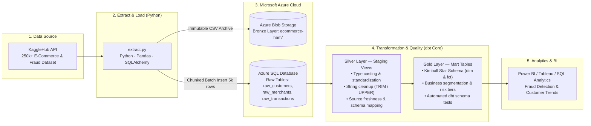
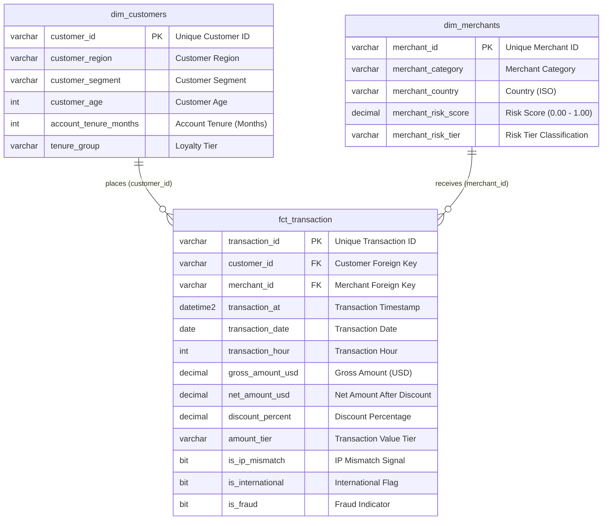

<div align="center">

# 🛒 E-Commerce Cloud ELT Pipeline — Azure & dbt Core

### *End-to-End Modern Data Warehouse for 250k+ E-Commerce & Fraud Analytics Transactions*

[](https://www.python.org/)
[](https://azure.microsoft.com/)
[](https://azure.microsoft.com/en-us/products/azure-sql/database/)
[](https://www.getdbt.com/)
[](#-dimensional-modeling-star-schema)
[](#-security--best-practices)

</div>

---

## 📌 Overview

This project implements a production-style **Cloud ELT (Extract, Load, Transform)** data warehouse processing **250,000+ e-commerce transactions** for customer behavior and fraud analytics.

- **Extract & Load (`extract.py`):** Pulls raw datasets via KaggleHub, archives immutable CSV snapshots to **Azure Blob Storage (Bronze Data Lake)**, and bulk-loads raw tables into **Azure SQL Database** using chunked `fast_executemany` batch inserts.
- **Transform & Test (`ecommerce_dbt/`):** Uses **dbt Core** directly inside Azure SQL to standardize staging views (**Silver**) and materialize a **Kimball Star Schema** (**Gold**) backed by automated data quality tests.

---

## 🏛️ Architecture



---

## 🥉🥈🥇 Medallion Architecture Layers

| Layer | Technology | Materialization | Purpose |
| :--- | :--- | :--- | :--- |
| **Bronze (Raw Archive)** | Azure Blob Storage | CSV Files (`ecommerce-ham/`) | Immutable historical archive of raw source files from Kaggle. |
| **Raw Landing** | Azure SQL Database | Tables (`raw_*`) | High-throughput batch-loaded raw tables ingested via `extract.py`. |
| **Silver (Staging)** | dbt Core | SQL Views (`stg_*`) | Standardized column naming, explicit type casting (`VARCHAR`, `INT`, `DECIMAL`, `BIT`), and string normalization. |
| **Gold (Marts)** | dbt Core | Physical Tables (`dim_*`, `fct_*`) | Analytics-ready **Kimball Star Schema** with derived business metrics, customer loyalty/risk tiers, and referential integrity. |

---

## 🌟 Dimensional Modeling (Star Schema)



---

## 🛡️ Automated Data Quality Tests (`dbt test`)

Defined in `ecommerce_dbt/models/marts/schema.yml` to prevent bad, duplicate, or orphaned records from reaching analytics:

| Test Type | Target Columns | Guarantee |
| :--- | :--- | :--- |
| **`unique` & `not_null`** | `transaction_id`, `customer_id`, `merchant_id` | Strict primary key integrity across all fact and dimension tables. |
| **`relationships`** | `fct_transaction.customer_id` → `dim_customers`, `merchant_id` → `dim_merchants` | Enforces referential integrity between facts and dimensions. |
| **`accepted_values`** | `dim_merchants.merchant_risk_tier` | Validates domain constraints on merchant risk classifications. |
| **`not_null`** | `gross_amount_usd`, `is_fraud` | Guarantees completeness of critical financial and fraud labels. |

---

## 📂 Repository Structure

```text
ecommerce-elt-azure-dbt/
├── .env.example              # Environment variable template (zero secrets)
├── .gitignore                # Excludes .env, .venv, dbt target/ & logs/
├── requirements.txt          # Python & dbt dependencies
├── extract.py                # Kaggle -> Azure Blob Storage & Azure SQL ingestion
├── README.md                 # Project documentation
└── ecommerce_dbt/            # dbt Core transformation project
    ├── dbt_project.yml
    └── models/
        ├── staging/          # Silver Layer (Views)
        │   ├── sources.yml
        │   ├── stg_customers.sql
        │   ├── stg_merchants.sql
        │   └── stg_transaction.sql
        └── marts/            # Gold Layer (Kimball Star Schema Tables)
            ├── schema.yml    # Automated dbt data quality tests
            ├── dim_customers.sql
            ├── dim_merchants.sql
            └── fct_transaction.sql
```

---

## 🚀 Quick Start

### 1. Prerequisites
- Python 3.10+
- [Microsoft ODBC Driver 18 for SQL Server](https://learn.microsoft.com/en-us/sql/connect/odbc/download-odbc-driver-for-sql-server)
- Microsoft Azure account with **Azure Blob Storage** and **Azure SQL Database**
- Kaggle credentials configured for `kagglehub`

### 2. Clone & Install Dependencies
```bash
git clone https://github.com/blgnr1/ecommerce-elt-azure-dbt.git
cd ecommerce-elt-azure-dbt

python -m venv .venv
# Windows:
.venv\Scripts\activate
# Linux / macOS:
source .venv/bin/activate

pip install -r requirements.txt
```

### 3. Configure Environment Variables
Copy `.env.example` to `.env` and populate your Azure credentials:
```bash
cp .env.example .env
```

```ini
AZURE_STORAGE_CONN_STR="DefaultEndpointsProtocol=https;AccountName=<your_account>;AccountKey=<your_key>;EndpointSuffix=core.windows.net"
AZURE_SQL_SERVER="<your-server>.database.windows.net"
AZURE_SQL_DATABASE="<your_database>"
AZURE_SQL_USER="<your_username>"
AZURE_SQL_PASSWORD="<your_secure_password>"
```

### 4. Run Ingestion (Extract & Load)
```bash
python extract.py
```

### 5. Run dbt Transformations & Data Quality Tests
```bash
cd ecommerce_dbt
dbt debug   # Verify Azure SQL connection
dbt build   # Run models + execute all data quality tests
```

---

## 🔒 Security & Best Practices

- **Zero Hardcoded Secrets:** All cloud credentials are strictly isolated via `.env` and environment variables.
- **Encrypted Cloud Transport:** Azure SQL connections enforce TLS (`Encrypt=yes;TrustServerCertificate=no;`).
- **Clean Version Control:** `.gitignore` rules protect `.env`, `.venv`, dbt build artifacts (`target/`), and logs (`logs/`).

---

<div align="center">
  <sub>Built by <b>Kerem Bilginer</b> · <a href="https://www.linkedin.com/in/kerem-bilginer/">LinkedIn</a> · <a href="https://www.blgnr1.com/">Portfolio</a></sub>
</div>
