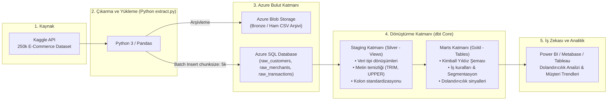
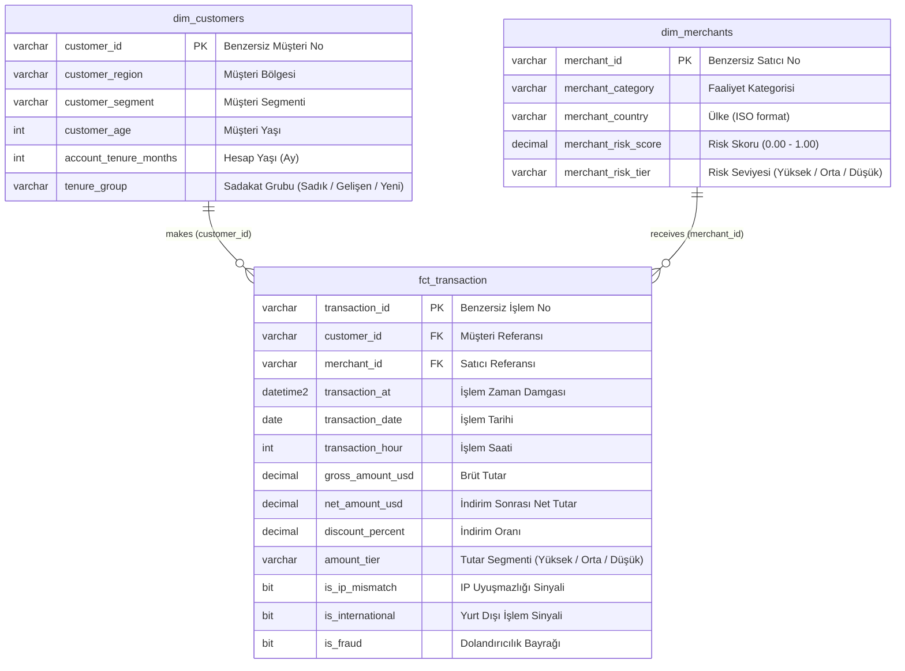

# 🛒 E-Commerce Data Engineering: End-to-End Modern ELT Pipeline

[](https://www.python.org/)
[](https://azure.microsoft.com/)
[](https://azure.microsoft.com/en-us/products/azure-sql/database/)
[](https://www.getdbt.com/)
[](#-veri-modelleme-star-schema)
[](#-g%C3%BCvenlik-ve-gizlilik-standartlar%C4%B1)

> **250.000+** satırlık e-ticaret işlem ve dolandırıcılık analitiği veri seti üzerinde çalışan, **Azure Bulut Altyapısı** ve **dbt (data build tool)** ile güçlendirilmiş kurumsal düzeyde uçtan uca ELT (Extract - Load - Transform) veri ambarı projesi.

---

## 📌 İçindekiler
- [Mimari Genel Bakış](#-mimari-genel-bakış)
- [Madalyon Veri Katmanları (Medallion Architecture)](#-madalyon-veri-katmanları-medallion-architecture)
- [Veri Modelleme (Star Schema)](#-veri-modelleme-star-schema)
- [Veri Kalitesi ve Otomatik Testler (Data Quality)](#-veri-kalitesi-ve-otomatik-testler-data-quality)
- [Proje Klasör Yapısı](#-proje-klasör-yapısı)
- [Kurulum ve Çalıştırma Rehberi](#-kurulum-ve-çalıştırma-rehberi)
- [Güvenlik ve Gizlilik Standartları](#-güvenlik-ve-gizlilik-standartları)

---

## 🏛️ Mimari Genel Bakış

Sistem modern veri mühendisliği prensiplerine uygun olarak **ELT** yaklaşımıyla inşa edilmiştir:
1. **Extract & Load (EL):** Python ve KaggleHub aracılığıyla veri kaynağından ham veriler çekilir; doğrudan **Azure Blob Storage (Data Lake Bronze)** ve **Azure SQL Database (Raw Layer)** üzerine aktarılır.
2. **Transform (T):** Azure SQL üzerinde dbt kullanılarak ham veriler temizlenir, iş kuralları uygulanır ve analitiğe hazır **Yıldız Şemaya (Star Schema)** dönüştürülür.



---

## 🥉🥈🥇 Madalyon Veri Katmanları (Medallion Architecture)

| Katman | Teknoloji | Nesne Tipi | Açıklama |
| :--- | :--- | :--- | :--- |
| **Bronze (Ham Arşiv)** | Azure Blob Storage | CSV Dosyaları | Kaggle'dan inen verilerin değişmez, ham ve tarihsel yedek arşivi (`ecommerce-ham/`). |
| **Raw Staging** | Azure SQL Database | Fiziksel Tablo | Python ile toplu olarak basılan ham veritabanı tabloları (`raw_*`). |
| **Silver (Temizleme)** | dbt (Views) | SQL Görünümleri | Veri tiplerinin (`VARCHAR`, `INT`, `DECIMAL`, `BIT`) düzeltildiği, boşlukların temizlendiği ara katman (`stg_*`). |
| **Gold (İş Modeli)** | dbt (Tables) | Fiziksel Mart Tabloları | İş kurallarının, metriklerin ve referans bütünlüğü inner join'lerinin uygulandığı nihai analitik tablolar (`dim_*`, `fct_*`). |

---

## 🌟 Veri Modelleme (Star Schema)

Analitik sorguların performansını maksimize etmek ve karmaşık sorguları basitleştirmek amacıyla **Kimball Boyutsal Modelleme (Dimensional Modeling)** metodolojisi kullanılmıştır:



---

## 🛡️ Veri Kalitesi ve Otomatik Testler (Data Quality)

Veri ambarına hatalı, mükerrer veya tutarsız veri girmesini önlemek için dbt `schema.yml` üzerinde otomatik test mekanizmaları tanımlanmıştır:

* **Primary Key Doğrulama:** `transaction_id`, `customer_id` ve `merchant_id` alanlarında `unique` ve `not_null` testleri.
* **Referans Bütünlüğü (Referential Integrity):** `fct_transaction` tablosundaki `customer_id` ve `merchant_id` yabancı anahtarlarının boyut tablolarında kesinlikle var olduğunu garanti eden `relationships` testleri.
* **Değer Alanı Denetimi (Domain Testing):** `dim_merchants.merchant_risk_tier` alanında yalnızca izin verilen değerlerin (`['Dusuk Risk', 'Orta Risk', 'Yuksek Risk']`) bulunduğunu teyit eden `accepted_values` testi.
* **Finansal & Risk Alan Doğrulama:** `gross_amount_usd` ve `is_fraud` alanlarında `not_null` güvencesi.

---

## 📂 Proje Klasör Yapısı

```bash
E-Commerce-ETL/
├── .env.example             # Çevre değişkenleri şablonu (şifre içermez)
├── .gitignore               # Güvenlik ve gizlilik filtreleri
├── extract.py               # Kaggle -> Azure Blob & SQL Pipeline scripti
├── README.md                # Proje dokümantasyonu
│
└── ecommerce_dbt/           # dbt Dönüşüm Projesi
    ├── dbt_project.yml      # dbt proje konfigürasyonu
    ├── .gitignore           # dbt log ve derleme filtreleri
    │
    └── models/
        ├── staging/         # Silver Katmanı (Views)
        │   ├── sources.yml
        │   ├── stg_customers.sql
        │   ├── stg_merchants.sql
        │   └── stg_transaction.sql
        │
        └── marts/           # Gold Katmanı (Kimball Star Schema Tables)
            ├── schema.yml   # Veri kalitesi testleri ve dokümantasyon
            ├── dim_customers.sql
            ├── dim_merchants.sql
            └── fct_transaction.sql
```

---

## 🚀 Kurulum ve Çalıştırma Rehberi

### 1. Ön Gereksinimler
* Python 3.10+
* [ODBC Driver 18 for SQL Server](https://learn.microsoft.com/en-us/sql/connect/odbc/download-odbc-driver-for-sql-server)
* Aktif bir Azure Hesabı (Azure Storage Account & Azure SQL Server)
* Kaggle API anahtarı

### 2. Projeyi Klonlayın ve Bağımlılıkları Yükleyin
```bash
git clone https://github.com/blgnr1/ecommerce-elt-azure-dbt.git
cd ecommerce-elt-azure-dbt

# Sanal ortam oluşturma ve etkinleştirme
python -m venv .venv
# Windows için:
.venv\Scripts\activate
# Linux/macOS için:
source .venv/bin/activate

# Gerekli paketleri kurun
pip install pandas sqlalchemy pyodbc azure-storage-blob python-dotenv kagglehub dbt-sqlserver
```

### 3. Çevre Değişkenlerini Tanımlayın
`.env.example` dosyasını `.env` olarak kopyalayın ve kendi Azure bilgilerinizi doldurun:
```bash
cp .env.example .env
```

```ini
AZURE_STORAGE_CONN_STR="DefaultEndpointsProtocol=https;AccountName=...;AccountKey=...;EndpointSuffix=core.windows.net"
AZURE_SQL_SERVER="sunucunuz.database.windows.net"
AZURE_SQL_DATABASE="veritabani_adiniz"
AZURE_SQL_USER="kullanici_adiniz"
AZURE_SQL_PASSWORD="guclu_sifreniz"
```

### 4. EL Pipeline'ını Çalıştırın
Kaggle'dan veriyi indirip Azure Blob Storage ve Azure SQL Database'e aktarır:
```bash
python extract.py
```

### 5. dbt Dönüşümlerini ve Testlerini Koşun
```bash
cd ecommerce_dbt

# Bağlantıyı test edin
dbt debug

# Tüm modelleri derleyin ve tabloları oluşturun
dbt run

# Veri kalitesi testlerini çalıştırın
dbt test

# Alternatif olarak hepsini tek adımda çalıştırın:
dbt build
```

---

## 🔒 Güvenlik ve Gizlilik Standartları

Bu projede güvenlik en ön planda tutulmuştur:
- **Zero-Secret Codebase:** Kaynak kodların hiçbirinde (`.py`, `.sql`, `.yml`) açık kimlik bilgisi veya parola bulunmaz; tamamı `.env` ve ortam değişkenleri ile izole edilmiştir.
- **Güçlü `.gitignore` Koruması:** Hem kök dizinde hem de dbt alt dizininde `.env`, `.venv`, derleme çıktıları (`target/`) ve dbt işlem günlükleri (`logs/`) sürüm kontrolü dışına alınmıştır.
- **Uçtan Uca Şifreli İletim:** Azure SQL bağlantısı zorunlu TLS/SSL şifrelemesi (`Encrypt=yes;TrustServerCertificate=no;`) ile sağlanarak Man-in-the-Middle saldırılarına karşı korunmaktadır.

---

<p align="center">
  Geliştirici: <b>Kerem</b> • Modern Veri Ambarı ve Mühendisliği Projesi 🚀
</p>
